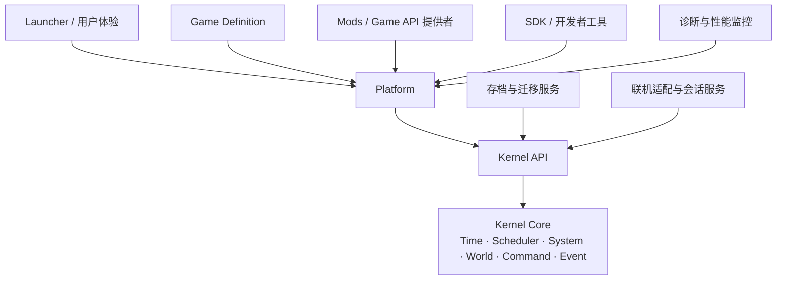

# 总体架构与模块责任清单

- 状态：按现有 01–04 规范整理的架构视图；具体接口待实现验证
- 依据：`Project Architecture v1.0.md`、`Kernel Contract v1.0.md`、`Mod Platform Specification v1.0.md`、`Save & Compatibility Specification v1.0.md`

## 1. 分层与依赖方向

依赖约束：Kernel Core 不依赖 Platform、具体游戏、Mod、脚本宿主、文件系统或网络。Platform 可以使用 Kernel API，不能直接写入 World 内部状态。客户端表现通过受控输入影响模拟，不直接改权威状态。Game API 由领域 Mod 发布，不是 Kernel 固定组成。

## 2. 模块责任与契约

| 模块 | 职责与主要输入/输出 | 状态所有权 | 依赖与禁止事项 | 主要失败处理 |
|---|---|---|---|---|
| **Time** | 管理逻辑 Tick、成功推进和溢出检查。输入为一次 step 请求；输出为当前/下一 Tick。 | 当前 Tick。 | 属于 Kernel；不读墙上时钟，不把 Tick 等同渲染帧。 | 溢出或非法推进拒绝 step；不静默回绕。 |
| **Scheduler** | 校验 System 依赖图，按阶段、拓扑关系和稳定 ID 形成执行计划。 | System 注册表及有效调度计划。 | Kernel 内部；不依据安装顺序、线程完成时间或哈希遍历排序。 | 无效依赖、循环或冲突拒绝计划，并返回可定位错误。 |
| **System** | 在受控读取权限内执行逻辑，产生 Command；声明读写、阶段、依赖、预算和确定性资格。 | System 定义由所属 Mod/平台注册；执行期局部输出由 Kernel 调度。 | 不直接写 World，不调用隐式外部输入。 | 丢弃失败 System 的未提交输出；是否继续 Tick 由冻结的故障策略决定。 |
| **World** | 保存实体、组件、Resource 和实体分配器；提供稳定的只读查询及内部提交接口。 | 权威模拟状态。 | 只有 Kernel 提交路径可变更；查询结果受稳定排序约束。 | 非法引用或 Schema 拒绝操作；核心不变量破坏进入故障状态。 |
| **Command** | 验证来源、权限、Tick、顺序、目标和 Schema；原子应用单条命令并记录提交/拒绝结果。 | 待处理命令与命令身份/序号规则。 | 权威写入唯一入口；不能靠 API 调用绕过。 | 普通命令错误只拒绝该条；命令内事务失败不留部分修改；核心故障停止模拟。 |
| **Event** | 记录已提交命令事实、明确的领域事件和进入模拟的输入事实；按稳定次序封存 Tick 输出。 | 当前 Tick 的事件批次；长期领域状态由对应 Mod 保存。 | 不是第二条写入通道；消费者修改 World 必须提交 Command。 | 未提交事实不能发布为成功事件；事件载荷/预算超限需显式报错。 |
| **Kernel API** | 对 Platform 与受控运行时开放读、注册、命令、事件、快照、恢复和错误契约。 | 公开类型与 API 版本的权威定义。 | 隔离内部实现；不能由多个模块各自定义同名异义类型。 | 稳定错误码、关联操作及恢复指引。 |
| **Mod Manifest / Validator** | 解析 Manifest、校验字段/Schema/内容摘要并生成诊断。 | Manifest 版本和校验结果。 | Platform；不把权限申请当授权。 | 指明文件、字段、错误码及修复建议；非法包不进入解析。 |
| **Mod Resolver / Lockfile** | 解析依赖闭包、版本/API 绑定、冲突和确定性加载计划；生成锁定结果。 | 本次运行的 Mod 组合和锁文件。 | Launcher 提交候选组合；Platform 必须按实际包重新验证；Kernel 不排序 Mod。 | 缺依赖、循环或模糊提供者时拒绝计划。 |
| **Mod Runtime / Lifecycle** | 按数据、受控脚本、受信任原生等执行方式完成加载、初始化、激活、停用和卸载。 | 生命周期、运行时配额和已注册能力。 | 通过 Host API 与 Kernel 交互；不可信原生代码不得在进程内被称为沙箱。 | 失败回滚注册；脚本输出在提交前校验；原生故障可能要求重建运行实例。 |
| **Permissions / API Registry** | 记录能力请求与实际授权；维护公开 API 的提供者、版本、Schema、权限及调用阶段。 | 授权结果、API 绑定。 | Platform；Mod 间通过公开契约，不访问私有实现。 | 缺权限或版本不匹配时拒绝并给出来源。 |
| **Save Compatibility Coordinator** | 检查目标配置与存档，规划迁移，在副本上验证并提交新存档。 | 存档兼容报告、迁移日志和迁移事务。 | Platform；Kernel 提供一致快照/恢复，不替 Platform 判断 Mod 兼容性。 | 保留原件；迁移失败回到恢复流程，不提交半成品。 |
| **Replay / Networking** | 将外部结果规范化为权威输入；记录、重放及联机协调输入/权威状态。 | 输入日志、会话和网络状态归 Platform/服务所有。 | 不直接写 World；第一版联机建议服务器权威。 | 版本/摘要不一致时在模拟前拒绝；网络故障按会话策略处理。 |
| **Diagnostics / Performance** | 汇总稳定错误、Tick 阶段耗时、Mod 预算和状态分歧信息。 | 诊断及非权威性能记录。 | 观察模拟，不改变模拟语义；过滤敏感内部信息。 | 记录不能替代错误处理或掩盖核心故障。 |
| **Game Definition / Game API** | 组合游戏身份、规则、必需 Mod/API、初始化、兼容范围和结束条件。 | 领域规则与其拥有的持久化状态由相应 Mod 所有。 | 使用 Kernel API；官方内容也走 Mod 体系，不硬编码到 Kernel。 | 不兼容组合拒绝启动或要求显式迁移。 |
| **Launcher** | 选择 Game Definition、展示 Mod 组合、冲突、权限和兼容报告，并启动运行时。 | 用户偏好/本地配置由客户端设置服务保存。 | 可生成候选计划，不能取代 Platform 的最终验证；不能直接写 World。 | 给用户可行动的错误与恢复选项。 |
| **SDK / CI / 测试** | 提供建包、Schema 校验、兼容/确定性测试、示例和自动质量门禁。 | 测试夹具、API/Schema 工件和验证报告。 | 不作为运行时权威状态所有者；工具版本应锁定。 | 未执行检查不得报告通过；失败须定位到任务和契约。 |

## 3. 关键数据流

1. Launcher 提交候选 Mod 组合；Platform 校验实际 Manifest、依赖、权限与内容摘要，产生锁定配置。
2. Platform 初始化 Game Definition 与 Mods；注册事务成功后才激活 System/API。
3. 外部输入变为已排序的 Command；Kernel 验证并逐条提交。
4. System 读取受授权状态并生成 Command；Kernel 按计划提交，Event 在事实成立后封存。
5. Kernel 在成功边界提供规范状态摘要和一致性快照；Platform 负责持久化、迁移、网络与报告。

## 4. 第一阶段最小实现边界

第一阶段只证明最短端到端路径：构建/启动、Tick、最小 World、受控 Command、一个 System、一组 Event、一个可验证的 Mod、快照恢复、状态摘要和自动测试。Launcher 可用命令行或测试工具替代；不实现商店、完整 UI、热加载、联机服务、任意原生 Mod 或 300+ 容量承诺。
